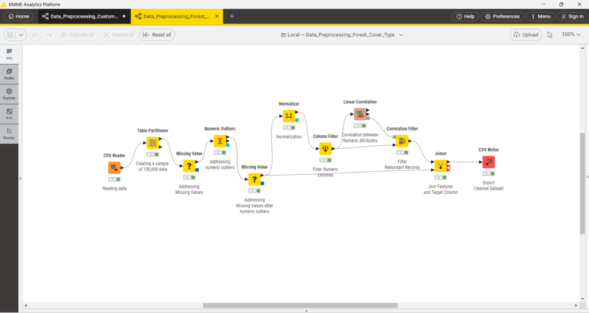
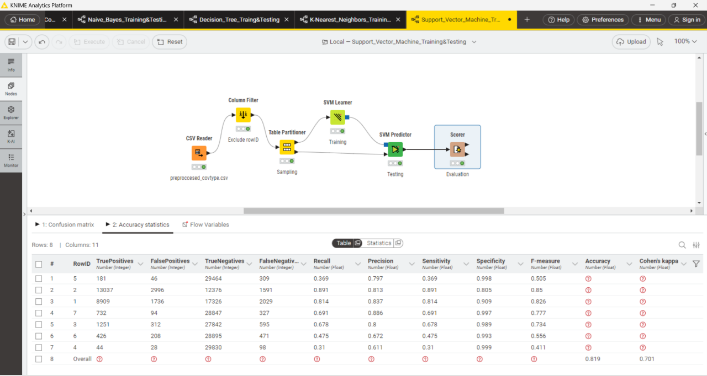
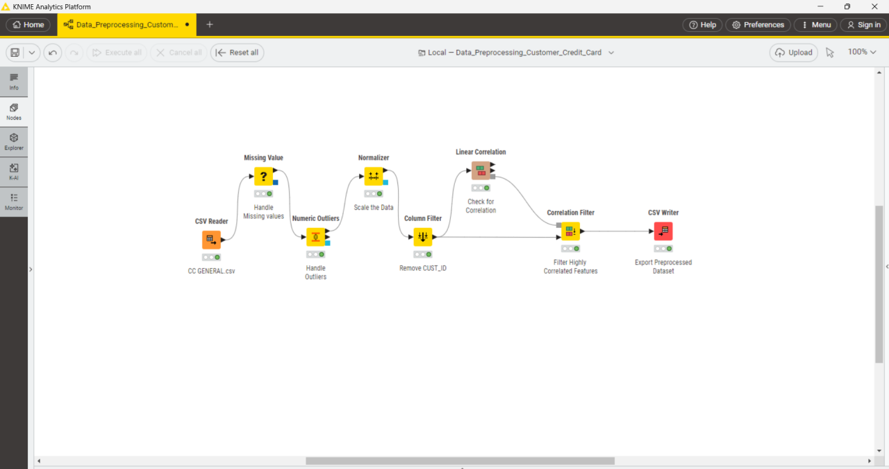
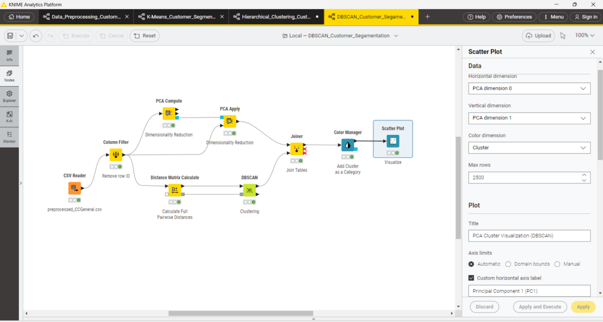

# Data Mining Using KNIME

## Overview
This repository contains two KNIME projects: **Classification Techniques using KNIME** and **Clustering Algorithms in KNIME**.

For classification, the **Forest Cover Type Dataset** was sampled and preprocessed before model development. Separate KNIME workflow files (`.knwf`) were used to train and test **Naive Bayes**, **Decision Tree**, **K-Nearest Neighbors (KNN)**, **Support Vector Machine (SVM)**, and **Neural Network** models. A report compares these models using **accuracy, precision, recall, F1-score, and confusion matrices**, then explains the selected best-performing algorithm and why it is suitable.

For clustering, the **Credit Card Dataset** was sampled and preprocessed before model development. Separate KNIME workflow files (`.knwf`) were used to train and test **K-Means Clustering**, **Hierarchical Clustering 2**, and **DBSCAN**, with visualizations where needed. Model comparison was performed using **Silhouette Score**, **visual quality of clusters**, and **computational efficiency (processing time)**. 

## Classification on Forest Cover Type Dataset

This project applies supervised machine learning techniques in KNIME to predict forest cover types using the Forest Cover Type dataset. Five classification algorithms were implemented and evaluated: Naïve Bayes, Decision Tree, K-Nearest Neighbors (KNN), Support Vector Machine (SVM) with an RBF kernel, and Neural Network. The project covers data preprocessing, feature selection, model training, and performance evaluation to identify the most suitable classification algorithm for the dataset.

### Objectives

- Implement and compare five classification algorithms using KNIME.
- Prepare the dataset through missing-value handling, normalization, and feature selection.
- Evaluate model performance using accuracy, precision, recall, F1-score, and confusion matrices.
- Select the most suitable algorithm based on the evaluation results.

### Workflow

The classification process consists of the following stages:

1. **Data Import:** Load the Forest Cover Type dataset using the CSV Reader node.
2. **Data Preprocessing:** Convert the target variable `Cover_Type` to a categorical value, handle outliers and missing values, and normalize continuous features.
3. **Feature Selection:** Apply Pearson correlation analysis and a correlation filter with a threshold of 0.8 to reduce redundant continuous features.
4. **Data Sampling:** Use stratified sampling to select 100,000 records with a fixed random seed of 12345.
5. **Model Training and Testing:** Split the data into 70% training and 30% testing sets, stratified by `Cover_Type`.
6. **Model Evaluation:** Evaluate predictions using KNIME's Scorer node and compare the resulting metrics.

  

  <em>Figure 1: Data preprocessing workflow implemented in KNIME.</em>

### Algorithms Evaluated

- **Naïve Bayes**
- **Decision Tree** — Gini impurity
- **K-Nearest Neighbors (KNN)** — k = 5, Euclidean distance
- **Support Vector Machine (SVM)** — RBF kernel
- **Neural Network** — RProp multilayer perceptron with one hidden layer of 10 neurons

Each algorithm was implemented in a separate KNIME workflow.

### Results and Model Comparison

| Algorithm | Accuracy |
|---|---:|
| Naïve Bayes | 63.3% |
| Decision Tree | 80.6% |
| K-Nearest Neighbors (KNN) | 80.8% |
| Support Vector Machine (SVM, RBF) | **81.9%** |
| Neural Network | 68.3% |

SVM with an RBF kernel achieved the highest accuracy at 81.9%, followed closely by KNN and Decision Tree. Naïve Bayes recorded the lowest accuracy, while the Neural Network achieved moderate performance.

Precision, recall, F1-score, and confusion matrices were also examined to assess class-level performance. ROC curves and AUC results were not available for this seven-class classification task in the implemented KNIME evaluation.

### Selected Model

**Support Vector Machine (RBF kernel)** was selected as the best-performing algorithm based on its highest observed accuracy.

The selection also considered its ability to model nonlinear relationships and the preprocessing steps used in the workflow, including feature scaling, feature selection, and stratified sampling. The reported results support its selection among the five evaluated models; they do not establish that it outperforms every possible alternative.

  

  <em>Figure 3: Full workflow and accuracy statistics of SVM.</em>

### Repository Contents

- **Workflow Documentation:** Describes the KNIME nodes, configurations, and processing steps.
- **Results and Analysis Report:** Presents model comparisons, evaluation findings, and the model-selection rationale.
- **KNIME Workflows:** Separate workflows for preprocessing, model implementation, and evaluation.
- **Images:** Selected screenshots of the workflow, model comparison, and evaluation results.

### Tools and Technologies

- KNIME Analytics Platform
- Forest Cover Type dataset
- Supervised machine learning
- Data preprocessing and feature selection
- Classification model evaluation

### Conclusion

Five classification algorithms were implemented and compared using KNIME. SVM with an RBF kernel achieved the highest accuracy of 81.9% and was selected as the most suitable model among those evaluated. The project demonstrates a complete classification workflow, from data preparation and feature selection to model evaluation and comparison.

## Clustering on Credit Card Dataset

This project applies unsupervised machine learning techniques in KNIME to identify customer segments in the Credit Card dataset. Three clustering algorithms were implemented and evaluated: K-Means, Hierarchical Clustering, and Density-Based Spatial Clustering of Applications with Noise (DBSCAN).

The project covers data preprocessing, feature selection, normalization, cluster visualization, and performance evaluation to identify the most suitable clustering algorithm for the dataset.

### Objectives

- Implement and compare three clustering algorithms using KNIME.
- Prepare the dataset through missing-value handling, outlier removal, normalization, and feature selection.
- Evaluate clustering performance using Silhouette Scores, visualizations, and computational efficiency.
- Identify the most suitable clustering algorithm based on the evaluation results.

### Workflow

The clustering process consists of the following stages:

1. **Data Import:** Load the Credit Card dataset using the CSV Reader node.
2. **Data Preprocessing:** Handle missing values and remove outliers to improve data quality.
3. **Data Transformation:** Apply Z-Score normalization to standardize numerical features.
4. **Feature Selection:** Retain continuous numerical features and use correlation analysis with a threshold of 0.8 to remove redundant attributes.
5. **Dataset Preparation:** Export the cleaned and standardized dataset for use in separate clustering workflows.
6. **Model Training:** Implement K-Means, Hierarchical Clustering, and DBSCAN in separate KNIME workflows.
7. **Cluster Visualization:** Apply Principal Component Analysis (PCA) to reduce dimensionality and visualize clusters using scatter plots.
8. **Model Evaluation:** Compare the algorithms using Silhouette Scores, visual cluster separation, and processing time.

  

  <em>Figure 4: Data Preprocessing of Clustering.</em>

### Algorithms Evaluated

- **K-Means Clustering** — Evaluated with different numbers of clusters (k = 3, 4, and 5).
- **Hierarchical Clustering** — Implemented using average linkage and dendrogram analysis.
- **DBSCAN** — Density-based clustering used to identify dense regions and noise points.

Each algorithm was implemented in a separate KNIME workflow using the same preprocessed dataset.

### Results and Model Comparison

| Algorithm | Silhouette Score | Visual Cluster Quality | Computational Efficiency |
|---|---:|---|---|
| K-Means | 16.2% | Poor | Fastest |
| Hierarchical Clustering | 26.7% | Weak to moderate | Slowest |
| DBSCAN | **27.8%** | Slightly better | Moderate |

DBSCAN achieved the highest Silhouette Score of 27.8%, indicating slightly better cluster separation than Hierarchical Clustering and K-Means. The PCA visualizations also showed that DBSCAN identified distinct dense regions and isolated noise points.

K-Means was the fastest algorithm but produced the weakest cluster separation. Hierarchical Clustering revealed some subgrouping patterns but required the most processing time.

Overall, the relatively low Silhouette Scores and overlapping clusters indicate that the dataset does not exhibit strong natural clustering structure.

### Selected Model

**DBSCAN** was selected as the most suitable clustering algorithm among the three evaluated models.

Its selection was based on the highest observed Silhouette Score, slightly better visual separation, ability to identify density-based clusters, and reasonable computational efficiency. However, the improvement over the other algorithms was modest, and the overall clustering quality remained limited.

  

  <em>Figure 5: Full workflow of DBSCAN.</em>

### Repository Contents

- **Workflow Documentation:** Describes the KNIME nodes, configurations, preprocessing steps, and clustering implementations.
- **Results and Analysis Report:** Presents the model comparison, Silhouette Scores, visual assessments, computational efficiency, and model-selection rationale.
- **KNIME Workflows:** Separate workflows for data preprocessing, K-Means, Hierarchical Clustering, and DBSCAN.
- **Images:** Selected screenshots of workflow configurations, cluster visualizations, and evaluation results.

### Tools and Technologies

- KNIME Analytics Platform
- Credit Card dataset
- Unsupervised machine learning
- K-Means, Hierarchical Clustering, and DBSCAN
- Data preprocessing and feature selection
- Z-Score normalization
- Principal Component Analysis (PCA)
- Silhouette Score evaluation

### Conclusion

Three unsupervised machine learning algorithms were implemented and compared using KNIME for credit card customer clustering. DBSCAN achieved the highest Silhouette Score of 27.8% and provided slightly better cluster separation than the other methods. Although DBSCAN was selected as the most suitable algorithm among those evaluated, the results indicate that further parameter tuning and dimensionality reduction may be necessary to improve clustering quality.
